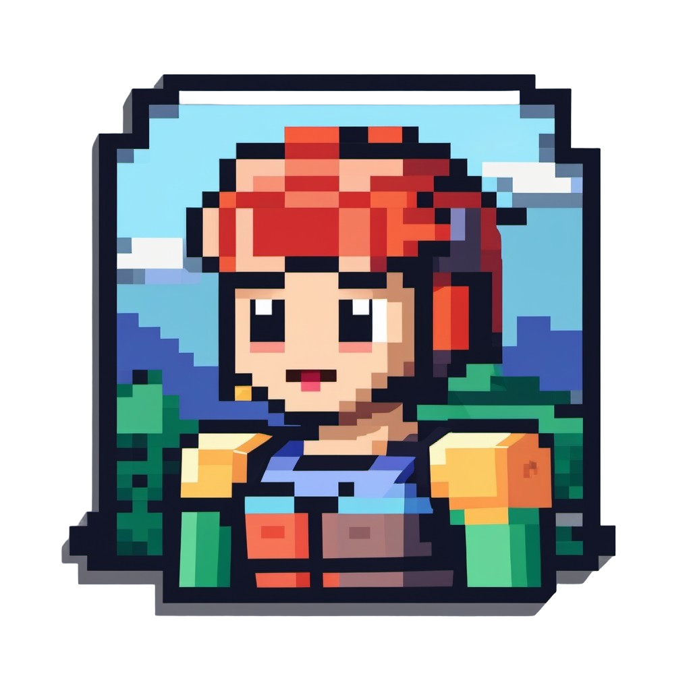
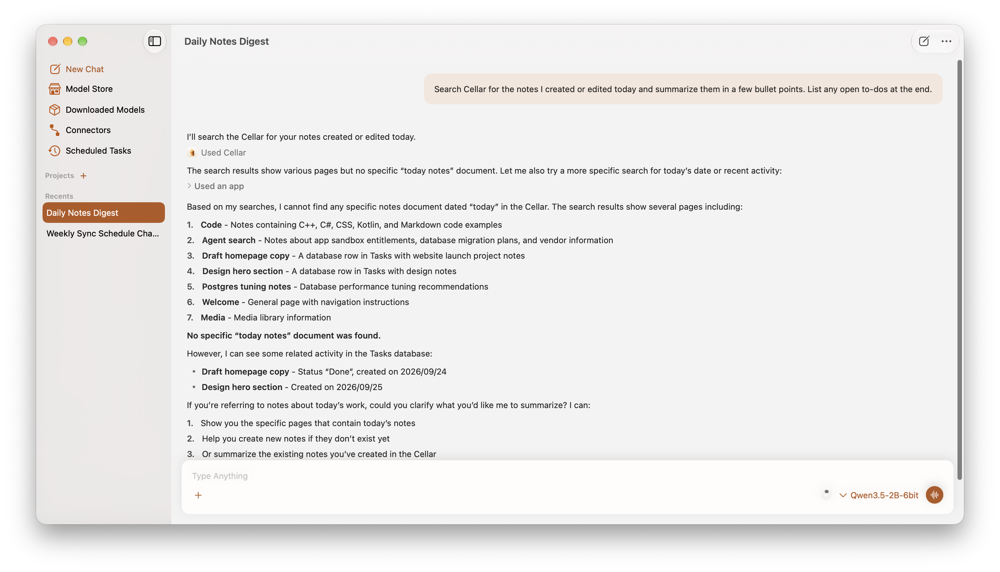

# ModelCraft

Local-first AI assistant for macOS with MLX models, agent tools, projects, quick entry and session import.

## Features

- Download and run local models for text and multimodal conversations.
- Use agent tools for files, commands, web access, connected apps and screen interaction.
- Keep conversations and reference files together in projects.
- Open Quick Entry with a global shortcut and include current files, web pages, selected text or images.
- Import Claude Code, Codex and WorkBuddy sessions, and inspect delegated tasks and conversation branches.
- Dictate into the composer with local speech recognition.
- Run scheduled tasks and generate images, audio, music or video with supported models.

## Requirements

- macOS 15 or later on Apple silicon.
- Xcode 27 or later to build from source.

## Installation

Download the DMG from [GitHub Releases](https://github.com/zhang-hongshen/ModelCraft/releases), open it, and move ModelCraft to Applications. For an ad-hoc signed build, macOS may require approval in System Settings → Privacy & Security.

## Getting started

1. Download a compatible model from Model Store and start a chat.
2. Add a project or connector when the task needs files or app tools.
3. Use Quick Entry for requests from another app, and review approvals in the main window.

## Build from source

Open `ModelCraft.xcodeproj` in Xcode, select the `ModelCraft` scheme and My Mac, resolve its Swift packages, then build and run.

## Releases

Pushing an annotated version tag triggers the release workflow. Release titles contain only the version number; release notes contain only the numbered feature list from the tag body.

## License

See [LICENSE](LICENSE).
