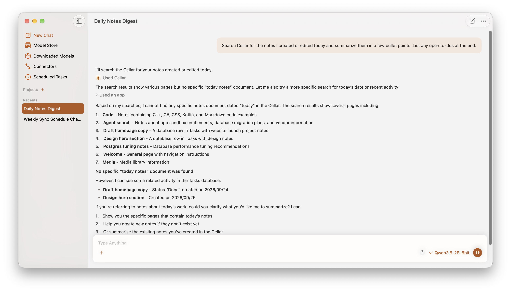
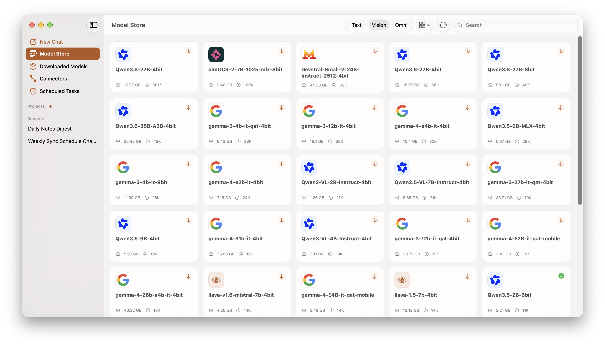
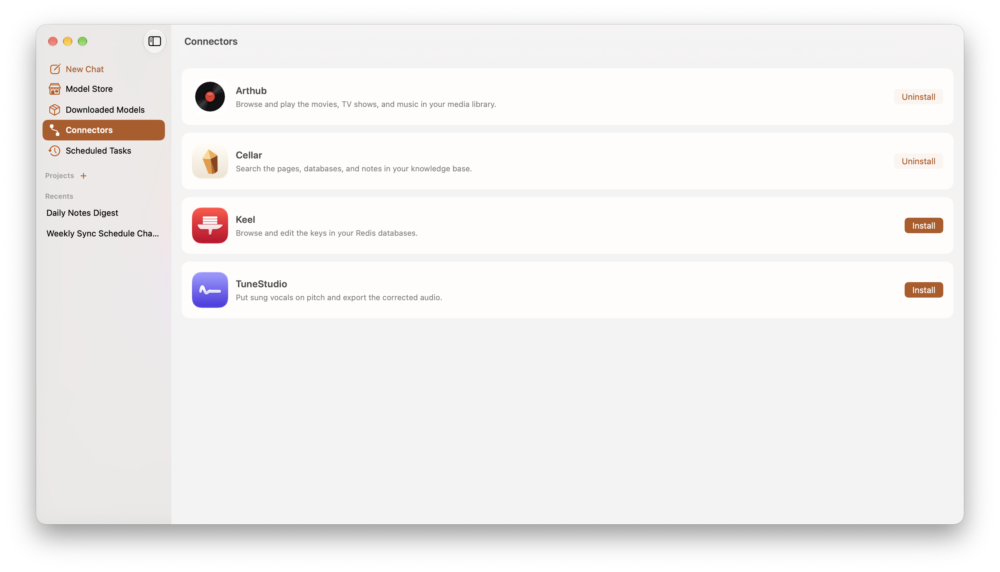
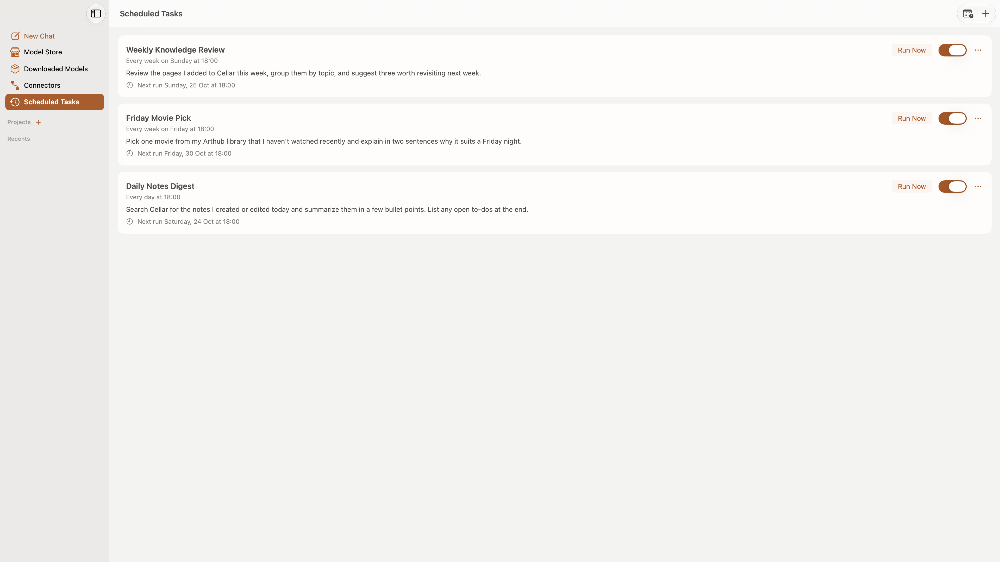

  

  
<strong>面向 macOS、本地优先的开源 AI 助手。</strong>

  

    
    
    
    
  

ModelCraft 在你的 Mac 上运行本地 AI 模型，帮你对话、调用工具、完成任务。

<picture>
  <source media="(prefers-color-scheme: light)" srcset="Screenshots/chat.png" />
  <source media="(prefers-color-scheme: dark)" srcset="Screenshots/chat-dark.png" />
  
</picture>

## ModelCraft 可以做什么

- **本地模型：** 在 Mac 上下载并运行模型。
- **多模态：** 文字、语音、图片、文档和音频。
- **项目：** 集中管理对话和文件。
- **Agent 工具：** 文件、命令、网页、Apple 应用和屏幕控制。
- **连接器：** 把 Mac 应用变成工具。
- **定时任务：** 按计划自动运行提示词。
- **媒体生成：** 图片、音频、音乐和视频。

<table>
  <tr>
    <td align="center" width="33%">
      <picture>
        <source media="(prefers-color-scheme: light)" srcset="Screenshots/model-store.png" />
        <source media="(prefers-color-scheme: dark)" srcset="Screenshots/model-store-dark.png" />
        
      </picture>
       模型商店
    </td>
    <td align="center" width="33%">
      <picture>
        <source media="(prefers-color-scheme: light)" srcset="Screenshots/connectors.png" />
        <source media="(prefers-color-scheme: dark)" srcset="Screenshots/connectors-dark.png" />
        
      </picture>
       连接器
    </td>
    <td align="center" width="33%">
      <picture>
        <source media="(prefers-color-scheme: light)" srcset="Screenshots/scheduled-tasks.png" />
        <source media="(prefers-color-scheme: dark)" srcset="Screenshots/scheduled-tasks-dark.png" />
        
      </picture>
       定时任务
    </td>
  </tr>
</table>

## 开始使用

### 系统要求

- macOS 15 或更高版本

### 安装

- 从 [GitHub Releases](https://github.com/zhang-hongshen/ModelCraft/releases) 下载最新的 DMG。
- Homebrew：即将推出。

## 文档

阅读[项目文档](https://deepwiki.com/zhang-hongshen/ModelCraft)。

## 许可证

ModelCraft 使用 [MIT License](./LICENSE) 开源。
